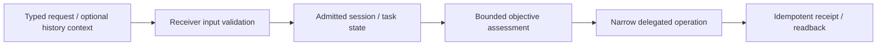

# Fork integration notes — Open WebUI receiver and local AI interfaces

**Scope:** source architecture of this public fork; **not** a production-control runbook.

This project preserves the upstream Open WebUI application and its own license/branding conditions. The owner's fork develops bounded Continuity-Agent receiver and context-admission code. Do not confuse source with an activated server, a ChatGPT client plugin, an approved executor, or authority over unrelated services.

A source test for the receiver does not prove a real external destination effect. Mandatory context gates, nonce/replay handling, malformed-payload rejection, user objective evaluation and negative authorization tests require evidence at exact source revision and intended caller. Provider app permissions and host-local execution permissions are independent.

The upstream **Open WebUI License** imposes additional branding and distribution conditions. Retain all upstream license/attribution/branding materials and review those conditions for releases; this note changes no brand assets or executable source. The document intentionally contains no secrets, internal addresses, private deployment routes or project-owned personal data.
